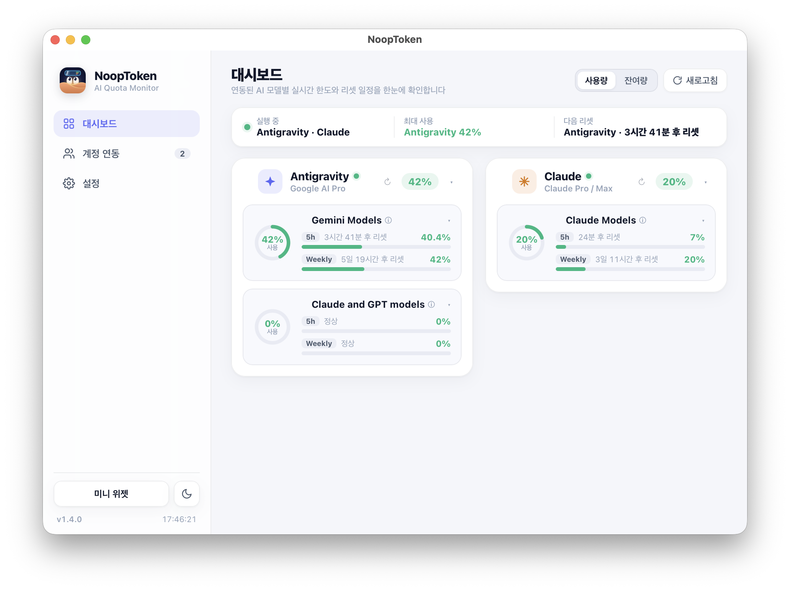
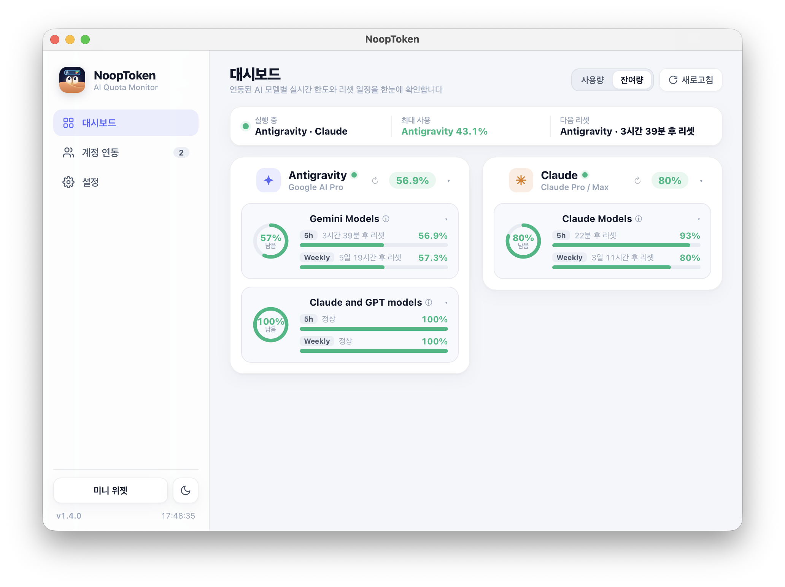
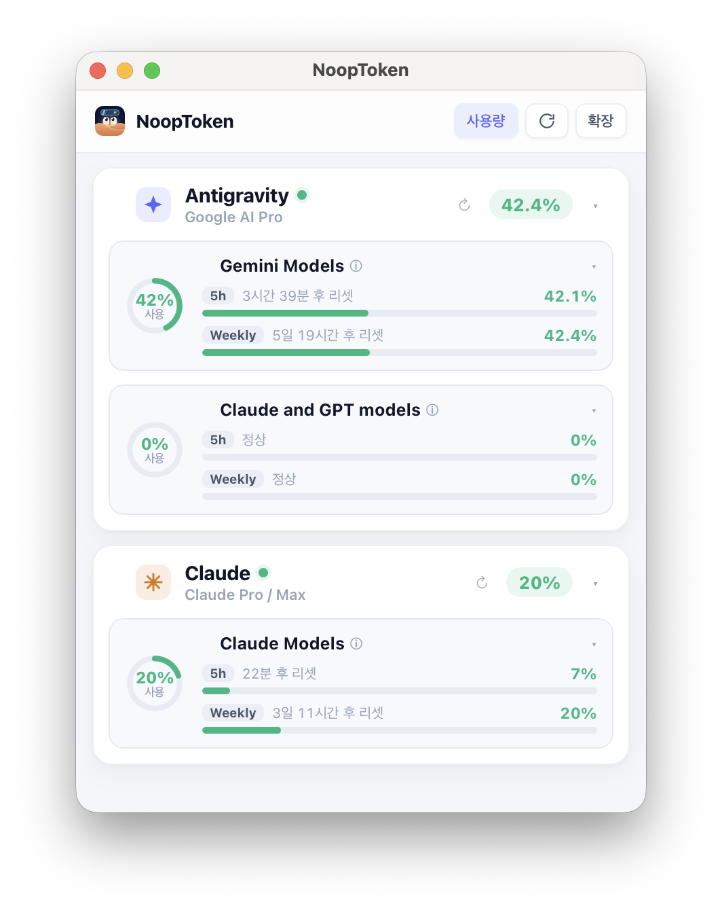
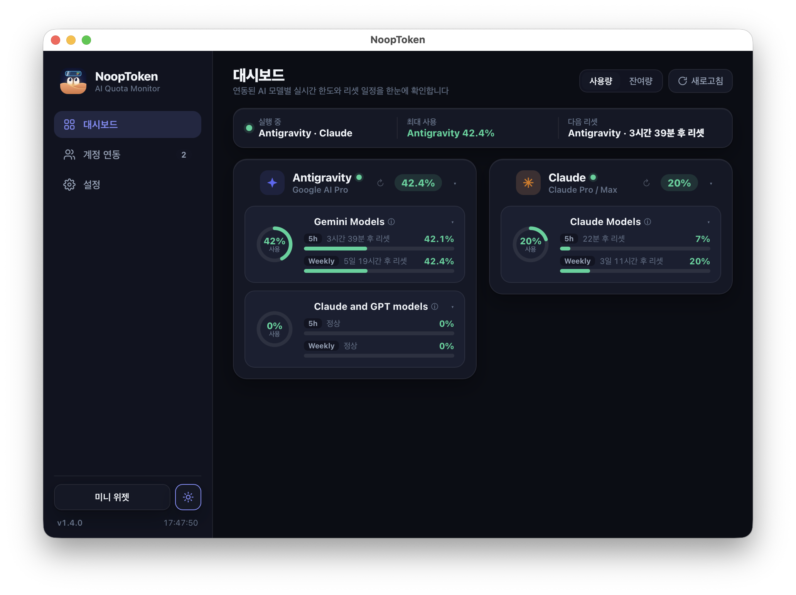
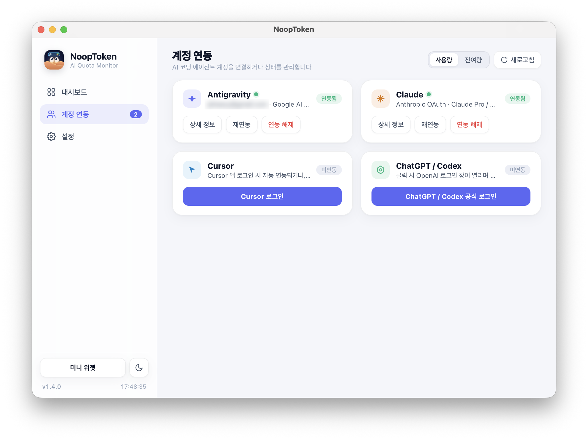
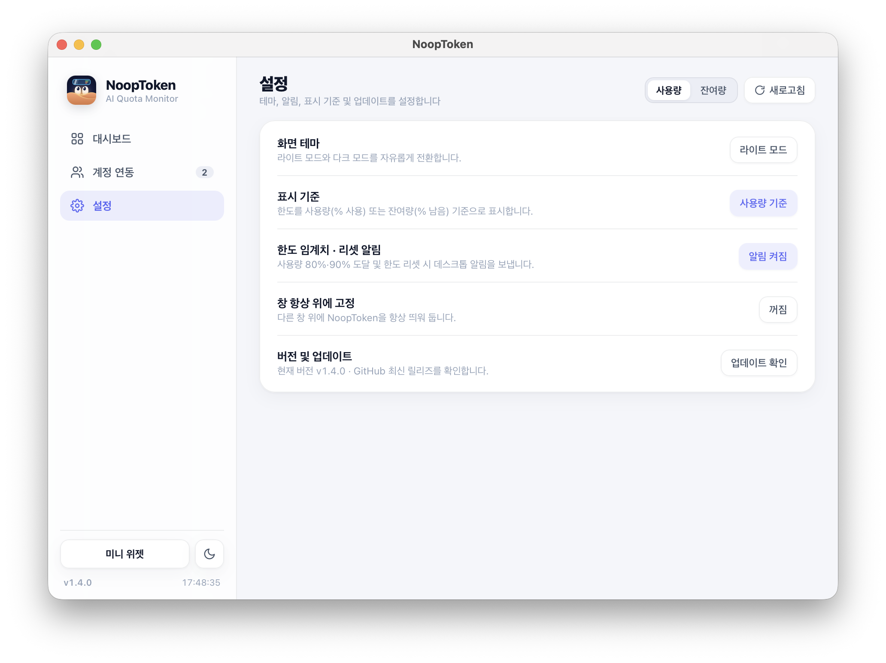

<p align="center">
  
</p>

<h1 align="center">NoopToken</h1>

<p align="center">
  <strong>Antigravity · Claude · Cursor · ChatGPT (Codex)</strong><br />
  4대 AI 코딩 에이전트의 <strong>공식 한도(5시간 · 주간 · 월간)</strong>를 바탕화면에서 실시간으로 확인하는 데스크톱 위젯
</p>

<p align="center">
  <a href="https://github.com/sungomi/NoopToken/releases/latest">
    
  </a>
  
  
</p>

> **코딩/파이썬 설치가 전혀 필요 없습니다!** 아래에서 본인 운영체제(Windows 또는 macOS)에 맞는 파일 하나만 받아 바로 실행하세요.

<p align="center">
  
</p>

---

## 📥 바로 다운로드 (최신 릴리즈)

| 운영체제 | 다운로드 링크 (클릭 시 바로 다운로드) | 실행 방법 |
| :--- | :--- | :--- |
| **🪟 Windows (PC)** | **[👉 NoopToken-Windows.exe 다운로드](https://github.com/sungomi/NoopToken/releases/latest/download/NoopToken-Windows.exe)** | 다운로드한 **`.exe` 파일을 더블클릭**하면 바로 실행됩니다. |
| **🍎 macOS (Mac)** | **[👉 NoopToken-macOS.dmg 다운로드](https://github.com/sungomi/NoopToken/releases/latest/download/NoopToken-macOS.dmg)** | **`.dmg` 파일을 열어 `NoopToken.app`을 `Applications` 폴더로 드래그**한 뒤 실행하세요. |

- 전체 릴리즈 내역 보기: **[GitHub Releases](https://github.com/sungomi/NoopToken/releases/latest)**

---

## ✨ 주요 기능 상세 안내

### 1. 실시간 통합 대시보드 & 상태 리본
- **상단 상태 리본**: 현재 PC에서 **실행 중인 AI 앱(초록 점 자동 감지)**, **최대 사용률**, **가장 가까운 리셋 일정**을 한 줄로 요약해 보여줍니다.
- **4대 AI 에이전트 공식 한도 조회**:
  - **Antigravity**: Google 공식 OAuth API 모델 그룹(`Gemini Models`, `Claude and GPT models`)별 **5시간(5h) / 주간(Weekly)** 한도
  - **Claude (Pro / Max / Claude Code)**: **5시간(5h) / 주간(Weekly)** 및 모델별 세부 주간 한도
  - **Cursor**: 월간 Fast Requests 사용량 · 잔여 횟수 및 리셋 주기
  - **ChatGPT / Codex**: **5시간(5h) / 주간(Weekly)** 및 코드 리뷰 한도
- **원형 게이지 + 정밀 바**: 카드마다 대표 사용률을 원형 링으로 표시하고, 내부에 5시간·주간 한도와 남은 리셋 시간을 깔끔하게 분리해 보여줍니다.
- **자유로운 배치 & 개별 새로고침**: 카드·모델 그룹을 마우스로 드래그(`⋮⋮`)해 순서를 바꿀 수 있으며, 전체·개별 새로고침 버튼(5초 쿨다운 적용)으로 즉시 갱신할 수 있습니다.

---

### 2. 사용량(`% 사용`) ↔ 잔여량(`% 남음`) 원클릭 전환
상단 헤더의 **`사용량 | 잔여량`** 토글 버튼으로 "얼마나 썼는지(`% 사용`)"와 "얼마나 남았는지(`% 남음`)" 기준을 즉시 전환할 수 있습니다.

<p align="center">
  
</p>

---

### 3. 미니 위젯 모드 (컴팩트 플로팅)
좌측 하단 **`미니 위젯`** 버튼을 누르면 `420×560` 크기의 슬림한 플로팅 위젯으로 축소됩니다.
- **연동된 AI 앱만 집중 표시**하여 코딩 중 화면 한쪽에 띄워두고 실시간 잔여 한도를 확인하기 좋습니다.
- 상단 **`확장`** 버튼으로 언제든 전체 대시보드로 돌아갈 수 있습니다.

<p align="center">
  
</p>

---

### 4. 화이트(라이트) 기본 테마 & 다크 모드 전환
- 기본적으로 깔끔한 **화이트(라이트) 디자인**으로 실행되며, 좌측 하단 달/해 아이콘 또는 설정 탭에서 **다크 모드**로 언제든 전환할 수 있습니다.
- Windows 10/11에서는 테마 전환 시 **네이티브 창 타이틀바 색상도 함께 실시간 동기화**되며, Per-Monitor V2 DPI 스케일링을 지원해 고해상도 모니터에서도 선명합니다.

<p align="center">
  
</p>

---

### 5. 원클릭 계정 연동 관리
좌측 **`계정 연동`** 탭에서 4대 AI 에이전트의 연결 상태를 한눈에 관리할 수 있습니다.
- **Chrome 기본 프로필 연동**: 크롬이 설치되어 있으면 기존 로그인된 크롬 창이 바로 열려 클릭 한 번으로 계정을 연동할 수 있습니다.
- **상세 정보 · 재연동 · 연동 해제**: 연결된 플랜/계정 정보를 확인하거나 원클릭으로 재연동·해제할 수 있습니다.
- **업데이트 시 로그인 영구 유지**: 모든 인증 토큰과 설정은 `~/.nooptoken.json`에 별도 보관되어 앱을 업데이트하거나 재설치해도 로그인이 유지됩니다.

<p align="center">
  
</p>

---

### 6. 맞춤 설정 · 임계치 데스크톱 알림 · 자동 업데이트
좌측 **`설정`** 탭에서 위젯 동작을 원하는 대로 제어할 수 있습니다.
- **한도 임계치 · 리셋 알림**: 사용량이 **80% / 90%에 도달**하거나 **한도가 리셋**될 때 macOS / Windows 네이티브 데스크톱 알림을 보냅니다.
- **창 항상 위에 고정**: 다른 작업 창 위에 NoopToken을 항상 띄워 둘 수 있습니다.
- **원클릭 자동 업데이트**: GitHub 최신 릴리즈를 자동 확인하며, 새 버전 출시 시 **`자동 업데이트`** 버튼 한 번으로 다운로드·교체·재시작까지 완료됩니다.

<p align="center">
  
</p>

---

## 🖥️ 처음 실행할 때 안내

### 1. Windows PC 사용자
1. **[NoopToken-Windows.exe](https://github.com/sungomi/NoopToken/releases/latest/download/NoopToken-Windows.exe)** 를 다운로드해 더블클릭합니다.
2. *"Windows의 PC 보호 (SmartScreen)"* 안내가 뜨면 **`추가 정보(More info)` → `실행(Run anyway)`** 을 누르면 바로 실행됩니다.

### 2. Mac (macOS) 사용자
1. **[NoopToken-macOS.dmg](https://github.com/sungomi/NoopToken/releases/latest/download/NoopToken-macOS.dmg)** 를 열어 **`NoopToken.app`** 을 **`Applications(응용 프로그램)`** 폴더로 드래그합니다.
2. 최초 실행 시 *"개발자를 확인할 수 없습니다 / 악성 코드가 없음을 확인할 수 없습니다"* 안내가 뜨면:
   - `시스템 설정 → 개인정보 보호 및 보안` 하단에서 **`확인 없이 열기`** 를 누르거나,
   - 터미널에서 아래 명령어를 한 번 실행한 뒤 여세요:
     ```bash
     xattr -dr com.apple.quarantine "/Applications/NoopToken.app"
     ```

---

## 🔐 다운로드한 파일 확인하기 (선택)

릴리스마다 `SHA256SUMS`(파일 지문표)와 `SHA256SUMS.sig`(sungomi의 서명)가 함께 올라갑니다.
받은 파일의 지문을 아래 명령으로 확인하고, `SHA256SUMS`에 적힌 값과 같으면 원본 그대로입니다.

- Mac: `shasum -a 256 받은파일이름`
- Windows (명령 프롬프트): `certutil -hashfile 받은파일이름 SHA256`

서명까지 확인하려면 (Mac/Linux):

```bash
echo "353765157+sungomi@users.noreply.github.com $(curl -s https://api.github.com/users/sungomi/ssh_signing_keys | python3 -c "import sys,json;print(json.load(sys.stdin)[0][\"key\"])")" > sungomi_signers
ssh-keygen -Y verify -f sungomi_signers -I 353765157+sungomi@users.noreply.github.com -n file -s SHA256SUMS.sig < SHA256SUMS
```

`Good "file" signature`가 나오면 sungomi가 서명한 지문표입니다.

---

## 제작자

**sungomi** · [github.com/sungomi](https://github.com/sungomi)

라이선스: [MIT License](LICENSE)
